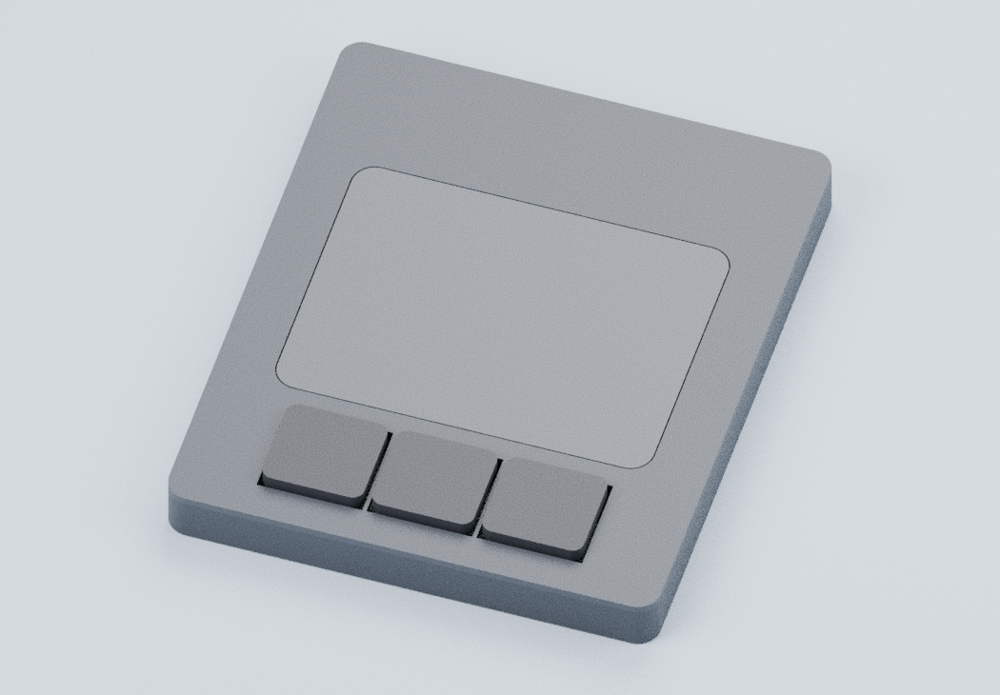
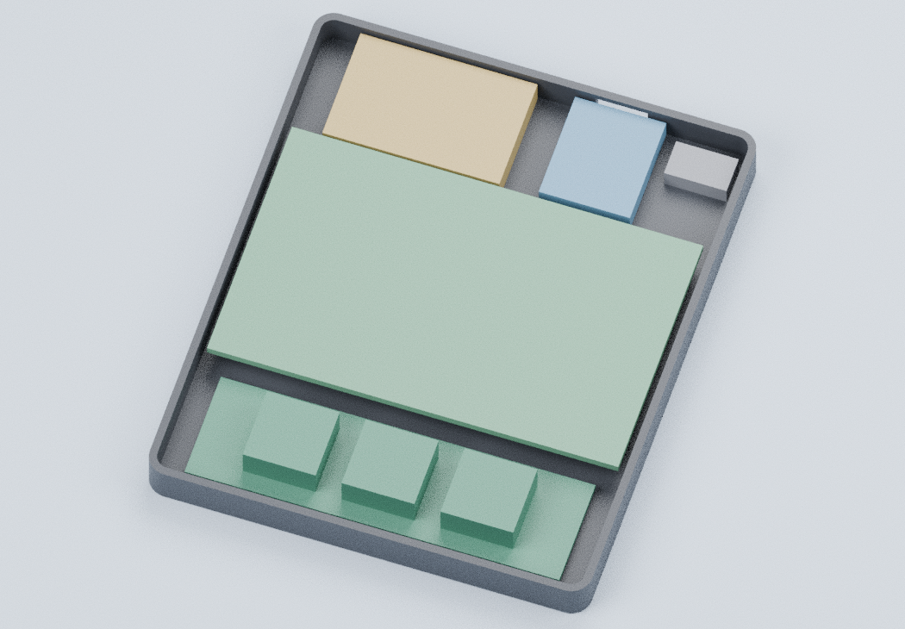
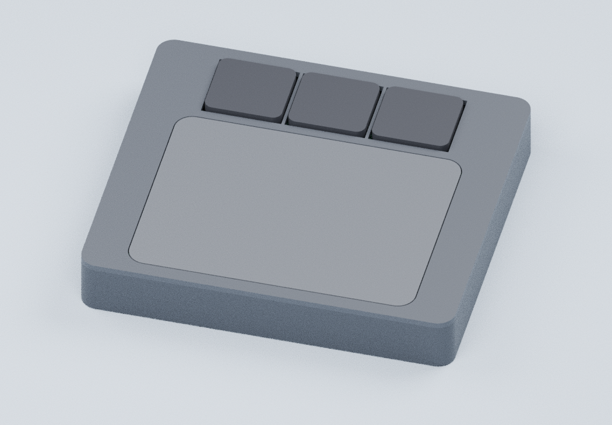

# GRT65 Black Edition — A0 設計

A0 は手持ちのトラックパッド、XIAO nRF52840、Choc V1 3個を使うレイアウト案。トラックパッドと3キーを左右中央に揃え、薄型案ではトラックパッド側にUSB-C、充電池、電源スイッチのスペースをまとめた。旧案の114 × 81 mmから85 × 102 mmへ変更し、幅を29 mm縮めた。

| 編集データ | 内容 |
|---|---|
| [OpenSCAD](../design/enclosure/grt65.scad) | ケース、上蓋、トラックパッド、キーと基板、電子部品の寸法モデル |
| [KiCad プロジェクト](../design/pcb/key-carrier.kicad_pro) | 3キー用の回路図と配置。キーの中心位置はケースと共通 |
| [KiCad 回路図](../design/pcb/key-carrier.kicad_sch) · [基板](../design/pcb/key-carrier.kicad_pcb) | 3個のスイッチを4線でXIAOへ接続するキーボード部 |

## 採用画像に合わせた外観案

[添付資料との照合結果](visual-reference-review.md) · [寸法検証・断面と部品候補](fit-and-part-selection.md)

**INFERRED** `layout = "reference"` は幅85 × 奥行76 mm。タッチ面の手前端からケース端までは3.5 mmで、電子部品用の帯を天面から取り除いた。使用時はトラックパッドが手前、3キーが奥。奥の側面にUSB-C、スイッチ、表示灯の開口を仮配置した。タッチ面の下に電池とXIAOを並べ、電池には34 × 22 × 5.5 mmの占有域を確保した。この枠には絶縁材と膨張余裕も含む。USB-Cの引き出し部品はキー基板の下に置く。画像の開口は位置確認用。

[奥の端子側から見た外観](../design/enclosure/reference.png)

**UNVERIFIED** この案の仮寸法ではキー頂点13.9 mm。12 mm目標を1.9 mm上回る。トラックパッド裏の部品と電池保護材、配線、アンテナ、USB-Cの引き出し方法は未確定。薄型電池や低背のUSB-C実装を選ぶ前に、実装高さと必要な電池容量を比較する。奥の側面の表示灯は開口のみで、回路と導光部品は未設計。

以下の寸法と検証結果は、部品をトラックパッドの手前側に平置きした85 × 102 mm案について記載する。

## 外箱と構造

**INFERRED** 外形85 × 102 mm、角R4。ケース上面9.5 mm、キー頂点11.6 mm（脚を除く）。キー間隔19 mm、左右の面はマットブラック、タッチ面はマットアクリルを想定する。トラックパッドより手前の天面はフラットに保ち、USB-Cと電源スイッチをその側面に配置する。スイッチ開口の寸法は部品選定後に決める。A0のケース材料は樹脂を前提とし、アルミ版はRF領域を樹脂窓に置換して別途評価する。

| 部位 | A0のモデル値 | 根拠・確認事項 |
|---|---:|---|
| トラックパッドの操作面 | 65 × 49 mm | **VERIFIED（資料）** PCBは1.6 mm、推奨マットアクリルは2 mm。捨て板込みの幅79 mmも内部に確保 |
| 底・側壁・上蓋 | 1.2、1.5、1.4 mm | **INFERRED** 形状確認用。たわみ、ねじ受け、固定爪は部品確定後 |
| キー基板 | 72 × 21 × 1.2 mm | **INFERRED** ケース底面から基板上面まで3.0 mm。スイッチ端子突出、はんだ、配線を要採寸 |
| キー頂点 | 11.6 mm | **INFERRED** 基板上面からキャップ頂点まで8.6 mmと仮定。目標12 mmに対するモデル上の差は0.4 mm |
| XIAOの空間 | 17.5 × 21 × 4.2 mm | **INFERRED** 基板外形の概略と部品込みの仮高さ。USB-Cの実位置、ケーブルの届き、保持具を要確認 |
| 電池の空間 | 34 × 22 × 5.5 mm | **INFERRED** 絶縁材と膨張余裕を含める枠。セル、保護回路、リードの曲げには実部品の仕様が必要 |
| スイッチの空間 | 12 × 7 × 4 mm | **INFERRED** トラックパッド側の予約領域。可動ノブと取付寸法は未選定 |

**UNVERIFIED** トラックパッドの底面部品と支持面の干渉、FFCの出口と曲げ半径、XIAOアンテナ周囲のクリアランス、キー最下点の擦れ、ケース固定方法。上蓋の穴はキャップの移動域。開口間は仮寸法で0.7 mmなので、材料と加工方法に合わせて共通開口も検討する。Chocを保持するプレートや支持部品の寸法は、実物を採寸して決める。合計高さはキャップの最大高さと積み上げ公差で再計算する。 [GR-Trackpad65 公式仕様](https://github.com/geek-rabb1t/GR-Trackpad65/blob/79e68a0a344df3488b5fa36183299b8b5d22439a/README.md) · [Seeed ピン図・寸法資料](https://wiki.seeedstudio.com/XIAO_BLE/)

## 電子部品とソフトウェア

- **VERIFIED（静的）** IQS550の信号とXIAOのI²Cは前回の[ピンマップ](pin-map.md)を引き継ぐ。D4/D5がI²C、D0はRDYの入力候補。FFCはモジュール直結のブレークアウト案で、端子面と実物の導通確認が必要。
- **INFERRED** 3キーは個別のアクティブLow入力。キー基板のJ1.1〜J1.4を順に左D1、中D2、右D3、GNDへ割り当て、XIAO側でプルアップとデバウンスを実装する。ヘッダーの穴は4線ハーネスの位置を表し、ケース内で低く収まる実装方式は要採寸。
- **INFERRED** キー基板裏面に各キー1か所、RGB LED用の4 × 4 mmの領域を予約。D6をデータ候補にする。LEDの電源・論理レベル・最大電流・消灯時の電流を確認し、必要に応じてレベル変換と電源ゲートを追加する。光はキー周縁へ拡散させる。LEDと導光パーツは部品選定後に設計する。
- **UNVERIFIED** USB-CはXIAOのコネクタを使用する案。保護付き1セルの定格、充電電流、バッテリー電圧範囲、USB接続時と電池時の電源経路を資料と測定で照合する。「オフで充電」と「オフで主回路停止」を両立するスイッチ・電源制御回路はその後に確定する。
- **INFERRED** ファームウェアはIQS550の通信確認を起点に、3キーとポインター・スクロールをBLE HIDでmacOSへ送る。RGBとキーマップの設定はBLE GATT経由の構成とし、macOS側では標準マウス操作、ショートカットで代替するジェスチャー、ネイティブマルチタッチを分けて検証する。

キー基板のスイッチフットプリントは KiSwitch の Choc V1 をMIT条件で使用。近接するスイッチとハーネスの配置を検討するためのソース。 [固定リビジョン](https://github.com/kiswitch/kiswitch/tree/aefcf65038d48d2666ff14530d482be3c350fa6e) · [MITライセンス](../design/pcb/GRT65.pretty/LICENSE-MIT)

## 検証と製造へ進む条件

**VERIFIED（クラウド内）** OpenSCAD 2021.01でケースと上蓋の3D形状を生成し、仮寸法で部品の占有域と全高を確認。KiCad 9.0.2で回路図ERCは0件、基板の回路図との不一致は0件、配置に対するDRC違反は0件。銅箔は未配線のため未接続が6件。ケースと基板の3キー中心、基板の外形と厚さはCAD同士で照合した。基板上の位置はそのままで、ケースに対する搭載位置を変更した。部品の平面占有域が丸角の内壁に収まり、相互に重ならないこともモデル上で確認した。

1. **UNVERIFIED** [採寸欄](stackup.md#a0-の採寸欄)に、手持ちの部品からキャップ頂点（静止／底打ち）、スイッチ足・はんだの突出、トラックパッド裏面の最大高さ、FFCの出口、USB-Cの実位置、アンテナの位置を記録する。各値でモデルを更新し、キャップの動作域と固定部を断面で確認する。
2. **UNVERIFIED** [ベンチ試験](bench-test-plan.md)でIQS550の通信とBLE HIDを確認し、電池・充電・電源スイッチ・RGBの回路条件を確定する。
3. **UNVERIFIED** キー基板と電源・RGBの結線を設計し、ERC、配線後DRC、アンテナ・充電・機械干渉を再確認する。固定部とUSB-Cのケーブル挿抜、導光部も確認してから製造データを用意する。

クラウドでは既存のOpenSCADとKiCadを使用。OpenSCADでは `part = "assembly"` で組立状態、`"tray"` と `"deck"` で外箱の各部を編集できる。実機への通電、加工、発注は行っていない。
